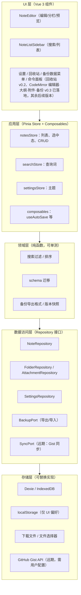

# TinyNote 技术架构文档

> 版本：v1.1（npm + Vue 3 方案，已评审通过）｜ 日期：2026-10-23 ｜ 状态：已定稿
> 配套文档：[功能点迭代文档](./ROADMAP.md)

---

## 1. 项目定位与核心约束

TinyNote 是一个**部署在 GitHub Pages 上的本地优先（local-first）Markdown 笔记应用**。

部署平台决定了两条硬约束，所有架构决策都由此推导：

| 约束 | 含义 | 架构影响 |
| --- | --- | --- |
| **无后端** | GitHub Pages 只托管静态文件，不能跑任何服务端代码 | 数据全部存浏览器端；"同步"只能通过导出文件或第三方 API（如 GitHub Gist）实现，永不自建服务器 |
| **静态托管** | 按路径刷新页面会 404；资源必须使用相对/带 base 前缀的路径 | 路由使用 Hash 模式；Vite 配置 `base` 适配仓库子路径 |

由此确立产品原则：**数据主权在用户**——所有笔记默认只存在用户自己的浏览器里，随时可以一键导出带走。

## 2. 技术选型

| 领域 | 选型 | 理由 | 备选方案 |
| --- | --- | --- | --- |
| 包管理 / 运行时 | **npm / Node 20 LTS** | 与 GitHub Actions runner 原生一致，零额外配置；lockfile 为 `package-lock.json`，CI 用 `npm ci` | pnpm / yarn（无必要收益） |
| 构建工具 | **Vite**（6+） | 原生 ESM、HMR 快、`base` 配置天然适配 Pages 子路径部署 | webpack（过重） |
| 框架 | **Vue 3.5+（SFC + `<script setup lang="ts">`）** | 组合式 API + 完整 TypeScript 支持；生态成熟、长期维护有保障 | React（评审时改为 Vue 3） |
| 路由 | **vue-router + `createWebHashHistory()`** | Pages 静态托管下 history 路由刷新即 404，Hash 路由零配置规避 | history 模式 + 404.html 跳转 hack（不推荐） |
| 状态管理 | **Pinia** | Vue 官方标配，setup store 写法极简；store 按功能域组织，action 调 Repository | Vuex（已被官方取代） |
| 响应式工具 | **@vueuse/core** | `useDark`（主题）、`watchDebounced`（搜索防抖）、`useEventListener` 等现成组合式函数，减少自写基础设施 | 自写 hooks |
| 持久化 | **IndexedDB，经 Dexie.js 封装** | 容量远超 localStorage 的 5MB 上限；原生支持 Blob（图片附件）；支持索引查询 | localStorage（仅存 UI 偏好）、OPFS（远期评估） |
| Markdown 渲染 | **markdown-it（默认 `html: false`）+ highlight.js** | 默认转义原始 HTML（安全基线）；插件生态成熟，任务列表、脚注等 v0.3 扩展直接加插件 | marked（默认不过滤 HTML，安全配置繁琐） |
| 代码编辑器 | 阶段一：受控 `textarea`（v0.1–v0.2）；阶段二升级 **vue-codemirror（CodeMirror 6）**，v0.3 已落地 | MVP 快速交付；CodeMirror 6 模块化、移动端友好、语法高亮可扩展，是迭代终态 | Monaco（桌面级体积，不适合移动场景） |
| 样式 | **Tailwind CSS 4 + @tailwindcss/typography** | 迭代 UI 速度最快；typography 插件直接给 Markdown 预览提供排版 | CSS Modules |
| PWA | **vite-plugin-pwa**（Workbox，v0.4 引入） | 一套配置获得离线缓存 + 桌面安装 | 手写 Service Worker |
| 搜索 | 阶段一：内存全量扫描；阶段二升级 **MiniSearch** | 数千篇以内直接扫描足够快；MiniSearch 支持前缀/模糊匹配，中文可配 n-gram 分词 | FlexSearch |
| 单元测试 | **Vitest + @vue/test-utils（happy-dom）+ fake-indexeddb** | 与 Vite 共享配置；fake-indexeddb 让存储层测试跑真实 Dexie 代码路径 | Jest |
| E2E 测试 | **Playwright** | 跨浏览器、自动等待、CI 友好 | Cypress |
| 类型检查 | **vue-tsc** | 覆盖 SFC 模板的类型检查，作为构建前置步骤 | — |
| 主键 / id | **UUID v7** | 时间前缀使主键近似有序，利于索引排序与未来多端同步合并 | 自增 id（不利于同步） |

## 3. 总体架构

### 3.1 分层架构



### 3.2 数据流与关键原则

1. **单向数据流**：组件只调用 store 的 action，action 通过 Repository 读写存储并更新 state，UI 自动响应。组件永远不直接触碰 IndexedDB。
2. **存储实现与业务解耦（Repository 模式）**：领域层和数据访问层定义的是接口，当前实现是 Dexie；未来切换 OPFS、远程同步时只替换实现，UI 与业务零改动。这是"可迭代"的第一支柱。
3. **软删除优先**：任何删除操作先进入回收站（`trashed` 标记），物理删除只发生在回收站过期清理。
4. **schema 版本化**：存储结构和备份格式都带 `schemaVersion`，只增不破；旧版本数据通过迁移函数单向升级。这是"可迭代"的第二支柱。
5. **离线优先**：不依赖任何网络请求即可完整使用；网络能力（PWA 更新检查、Gist 同步）都是增强项，失败可降级。

## 4. 数据模型与存储设计

### 4.1 实体定义（TypeScript，落地于 `src/types/index.ts`）

```ts
// 领域实体（v0.1 起即按此形态定义，后续字段只增不改）
export interface Note {
  id: string;              // UUID v7：时间有序，天然利于按时间索引与排序
  title: string;
  content: string;         // Markdown 原文（唯一事实来源，预览即渲染结果）
  folderId: string | null; // v0.2 启用
  tags: string[];          // v0.2 启用
  pinned: boolean;         // v0.2 启用
  trashed: boolean;        // v0.1 即启用：删除一律软删
  trashedAt: number | null;
  createdAt: number;
  updatedAt: number;
}

export interface Folder {
  id: string;
  name: string;
  order: number;
  createdAt: number;
}

export interface Attachment {   // v0.3 启用
  id: string;
  noteId: string;
  name: string;
  mime: string;
  size: number;
  blob: Blob;              // 图片二进制直接存 IndexedDB
  createdAt: number;
}

export interface NoteSnapshot { // v0.4 启用：历史版本
  id: string;
  noteId: string;
  content: string;
  createdAt: number;
}

export interface BackupFile {   // 备份格式 v1（v0.1–v0.2：JSON；v0.3 起附件改走 zip，见 4.4）
  format: 'tinynote-backup';
  schemaVersion: number;
  exportedAt: number;
  folders: Folder[];
  notes: Note[];
}
```

### 4.2 IndexedDB 库结构（Dexie）

```ts
const db = new Dexie('tinynote');

// v1（MVP）
// 注意：boolean/null 不是合法 IndexedDB 键，不索引 trashed 布尔字段；
// 回收站查询用 trashedAt 数值索引：where('trashedAt').above(0)
// （未删除笔记的 trashedAt 为 null，不会进入该索引）。
db.version(1).stores({
  notes: 'id, folderId, updatedAt, *tags, trashedAt',
  folders: 'id, name, order',
  settings: 'key',          // KV 表：主题、编辑器偏好、上次备份时间等
});

// v2（v0.3：新增附件表）—— 示例：迭代即追加 version + 迁移回调
db.version(2).stores({
  notes: 'id, folderId, updatedAt, *tags, trashedAt',
  folders: 'id, name, order',
  settings: 'key',
  attachments: 'id, noteId',
}).upgrade(async (tx) => { /* 无需改造旧数据，留空即可 */ });
```

要点：

- 索引覆盖高频查询：按 `folderId` 过滤、按 `updatedAt` 排序、按标签过滤、回收站查询。
- **为什么 trashed 不进索引**：IndexedDB 的键只支持 number/string/Date/Array/二进制，boolean 和 null 不是合法键。未删除笔记的 `trashedAt` 为 null，IndexedDB 会静默跳过（不报错、不入索引），因此 `trashedAt` 数值索引恰好等价于"回收站全集"。
- **schema 迁移机制**：每个 `db.version(n)` 携带 `upgrade` 回调；应用启动时 Dexie 自动比对版本并按序执行迁移。禁止出现"改字段不写迁移"的提交；已发布的 schema 定义不允许修改，只能追加新 version。
- `settings` 用 KV 表而非独立实体，避免偏好设置每次迭代都动库结构。

### 4.3 双存储分工

| 存储 | 内容 | 说明 |
| --- | --- | --- |
| IndexedDB（Dexie） | 笔记、文件夹、附件、历史版本 | 用户核心数据，唯一事实来源 |
| localStorage | 主题、编辑器偏好、最近打开的笔记 id 等轻量 UI 状态 | 丢了不心疼，且体积小、同步读取快（@vueuse/core 的 `useDark`/`useLocalStorage` 直接托管） |

### 4.4 备份与导出格式的演进

- **v0.1–v0.2**：全量备份 = 单个 `tinynote-backup-YYYYMMDD.json`。
- **v0.3 起**（引入附件 Blob 后）：全量备份 = `.zip` 包，内含 `manifest.json`（即上述 BackupFile 结构）+ `notes/*.md` + `assets/*`（附件原始文件）。JSON 与 Markdown 双格式并存：JSON 用于**精确还原**，Markdown zip 用于**通用可读**。
- 导入时校验 `format` 与 `schemaVersion`：版本 ≤ 当前 → 走迁移后导入；版本 > 当前 → 拒绝并提示升级应用。

## 5. 关键技术决策记录（ADR 摘要）

| # | 决策 | 结论与理由 |
| --- | --- | --- |
| ADR-001 | 路由模式 | **Hash 路由**（`createWebHashHistory`）。Pages 刷新 404 是硬伤，hash 路由零成本规避；笔记应用 URL 结构简单，hash 的 SEO 劣势无关紧要 |
| ADR-002 | 主存储 | **IndexedDB（Dexie）**。localStorage 5MB 上限与无 Blob 支持直接排除；OPFS 更接近文件系统但兼容性/工具链不如 Dexie 成熟，列为远期评估项 |
| ADR-003 | 主键策略 | **UUID v7**。时间前缀使主键即近似有序，省去额外排序索引；比自增 id 更适合未来多端同步合并 |
| ADR-004 | 编辑器分阶段 | 先 `textarea`（MVP 快速交付），v0.3 升级 vue-codemirror（CodeMirror 6）**（已完成）**。编辑器封装为独立组件，对外只暴露 v-model 式接口，升级对 store 层透明 |
| ADR-005 | 同步路线 | **不自建服务器**。顺序：手动导出导入（v0.3）→ GitHub Gist（v0.5，用户自己提供 PAT）→ File System Access API 直连本地文件夹（探索项） |
| ADR-006 | Markdown 安全 | markdown-it **默认 `html: false`**：源文本中的原始 HTML 标签一律转义；`v-html` 仅用于渲染 markdown-it 自身的输出（全项目唯一插口）；外链统一注入 `target="_blank"` + `rel="noopener noreferrer"` |
| ADR-007 | Markdown 库选型 | **markdown-it** 优于 marked：默认安全基线（转义而非放行 HTML）、插件生态（v0.3 的任务列表/脚注直接加插件）、`linkify` 配置齐备 |
| ADR-008 | 回收站索引 | 不索引 `trashed` 布尔字段（IndexedDB 键不支持 boolean/null），改用 `trashedAt` 数值索引表达"回收站全集"（见 4.2） |

## 6. 目录结构

```text
tinynote/
├── docs/                       # 本文档、ROADMAP、CHANGELOG
├── public/                     # 图标等静态资源
├── src/
│   ├── main.ts                 # 应用入口：createApp + Pinia + Router
│   ├── App.vue                 # 全局布局（顶栏 + 侧边栏 + RouterView）
│   ├── router/index.ts         # Hash 路由表
│   ├── assets/main.css         # Tailwind 入口 + hljs 代码高亮主题变量
│   ├── types/index.ts          # 领域实体（4.1 的落地文件）
│   ├── features/               # 按功能域组织（核心可迭代单元）
│   │   ├── notes/              #   NoteListSidebar / NotesView / NoteEditor
│   │   │   ├── stores/notes.ts           # Pinia：列表、回收站、选中态、过滤态、CRUD
│   │   │   ├── composables/useAutoSave.ts
│   │   │   └── notes.ts                  # 纯函数：displayTitle、makeExcerpt、置顶排序
│   │   ├── folders/             #   （v0.2）folders.ts + stores/folders.ts
│   │   ├── tags/                #   （v0.2）标签解析/统计纯函数
│   │   ├── trash/               #   （v0.2）trash.ts（30 天清理口径）+ TrashView
│   │   ├── search/             #   search.ts（纯过滤函数）+ highlight.ts + stores/search.ts
│   │   ├── editor/             #   （v0.3 已落地）NoteCodeEditor.vue（CodeMirror 封装）+ setup.ts（扩展组）
│   │   │   ├── attachments.ts             # 粘贴/拖入纯函数（准入/引用/插入）
│   │   │   └── stores/attachments.ts      # 附件 blob URL 生命周期
│   │   ├── backup/             #   （v0.3 已落地）backup.ts（manifest/迁移/命名纯函数）+ useBackup.ts（fflate 编排）
│   │   └── settings/           #   stores/settings.ts（主题 + 编辑器行号偏好）
│   ├── components/             # 跨功能通用 UI（AppHeader 等）
│   ├── composables/            # 跨功能组合式函数
│   ├── lib/
│   │   ├── db/                 # db.ts（Dexie + schema 迁移）+ repositories/
│   │   ├── markdown/render.ts  # markdown-it 管线（html:false、外链加固、hljs）
│   │   └── utils/              # id、time 等
│   └── __tests__/              # 单测（与被测代码同栈：vitest + fake-indexeddb）
├── .github/workflows/deploy.yml
├── vite.config.ts
├── tsconfig.json
└── package.json
```

原则：**每个 feature 目录自包含**（组件、store、纯函数、测试都在里面或邻近），新增功能 = 新增目录 + 注册路由，不动既有代码。Vue 侧的机制差异：hooks 对应 **composables**（`useAutoSave` 等），`watch`/`watchEffect` 驱动副作用，其余分层与数据流不变。

## 7. 构建与部署

### 7.1 base 路径适配

GitHub Pages 项目站点地址为 `https://<user>.github.io/<repo>/`，构建时注入仓库子路径：

```ts
// vite.config.ts
export default defineConfig({
  base: process.env.VITE_BASE ?? '/',
  // ...
})
```

CI 中传入 `VITE_BASE: /<仓库名>/`；自定义域名或用户主页站点（`<user>.github.io`）时传 `/`。

### 7.2 GitHub Actions 部署（push main 自动发布）

```yaml
name: Deploy to GitHub Pages
on:
  push:
    branches: [main]
permissions:
  contents: read
  pages: write
  id-token: write
concurrency:
  group: pages
  cancel-in-progress: true
jobs:
  build:
    runs-on: ubuntu-latest
    steps:
      - uses: actions/checkout@v4
      - uses: actions/setup-node@v4
        with:
          node-version: 20
          cache: npm
      - run: npm ci
      - run: npm run test:run          # 测试不过不发布
      - run: npm run build             # = vue-tsc --noEmit && vite build（类型检查前置）
        env:
          VITE_BASE: /${{ github.event.repository.name }}/
      - uses: actions/upload-pages-artifact@v3
        with:
          path: dist
  deploy:
    needs: build
    runs-on: ubuntu-latest
    environment:
      name: github-pages
      url: ${{ steps.deployment.outputs.page_url }}
    steps:
      - id: deployment
        uses: actions/deploy-pages@v4
```

发布纪律：打 git tag（如 `v0.3.0`）对应一次功能发布，`CHANGELOG.md` 记录每个版本的功能与迁移说明。

## 8. 性能与安全

| 主题 | 策略 |
| --- | --- |
| 自动保存 | 输入防抖 800ms 后写库 + 失焦立即保存 + `beforeunload`/`pagehide` 尽力 flush，杜绝"写了没存" |
| 搜索性能 | 输入防抖 200ms（`watchDebounced`）；MVP 内存扫描，笔记量 >5000 后切换 MiniSearch 倒排索引 |
| 长列表 | 列表项超过阈值（约 200 条可视）后引入虚拟滚动（`@tanstack/vue-virtual`） |
| 大文档 | 编辑器升级 CodeMirror 6 后，十万字符级文档流畅渲染；预览侧超长文档分块渲染 |
| XSS | markdown-it `html: false`（ADR-006）：Markdown 中的 HTML 标签一律按纯文本展示；`v-html` 全项目仅 Markdown 渲染一处插口；外链统一 `target="_blank"` + `rel="noopener noreferrer"`；附件图片（v0.3）只把 `tinynote-attachment://<id>` 替换为本地 blob URL（id 不进入属性，命中未映射时输出固定占位文案） |
| 隐私 | 无任何第三方统计/字体 CDN；数据不出浏览器。Gist 同步为用户显式开启并提供自己的 PAT，PAT 只存本机 localStorage |
| CSP | Pages 静态托管下建议通过 `<meta http-equiv="Content-Security-Policy">` 收紧脚本来源 |

## 9. 测试策略

| 层级 | 范围 | 工具 |
| --- | --- | --- |
| 单元测试（必须） | 领域层纯函数：搜索、排序、摘要、时间格式化、schema 迁移、备份导入校验、回收站过期计算 | Vitest |
| 存储层测试 | Repository 全量走真实 Dexie 代码路径（`fake-indexeddb` 提供 Node 环境下的 IndexedDB 实现） | Vitest + fake-indexeddb |
| 组件测试 | 编辑器保存行为、搜索交互、设置项持久化 | Vitest + @vue/test-utils（happy-dom） |
| E2E（关键路径） | 新建→输入→**不点保存**→刷新→数据仍在；删除→回收站恢复；导出→清库→导入还原 | Playwright |
| 发布门槛 | `npm run test:run` 在部署流水线中作为硬性门禁 | GitHub Actions |

## 10. 风险与对策

| 风险 | 影响 | 对策 |
| --- | --- | --- |
| 用户清浏览器数据 / 换浏览器 | 核心数据丢失 | 产品级对策：首次使用提示"导出备份"；v0.4 增加定期备份提醒；同步（v0.5）是最终解 |
| 隐私模式下 IndexedDB 可能被回收 | 同上 | 启动时检测存储持久化能力，申请 `navigator.storage.persist()`；检测到隐私模式时提示导出 |
| Pages 大陆访问不稳定 | 可用性 | 应用本体离线可用（PWA）；文档说明可选自定义域名 + CDN |
| 单文件笔记过大（粘贴超长日志） | 编辑/渲染卡顿 | CodeMirror 6 + 分块预览；单笔记超限（如 2MB）时提示 |
| 迭代引入不兼容 schema | 用户数据损坏 | schema 迁移单测覆盖（旧版本备份文件作为 fixture 回放）；发布前必跑 E2E 导入还原用例 |

---

## 附：术语表

- **local-first**：本地数据是第一公民，网络（同步/备份到云端）只是增强。
- **Repository**：领域层与存储层之间的接口层，屏蔽数据到底存在哪里、怎么存。
- **schemaVersion**：数据结构版本号，迁移函数把旧版本数据升级到新版本，保证老用户平滑升级。
- **composable**：Vue 组合式函数（`useXxx`），对应 React 世界的 hooks，负责封装可复用的响应式逻辑。
